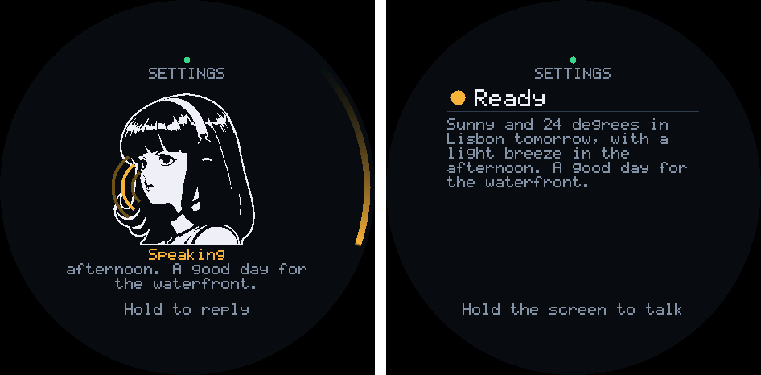
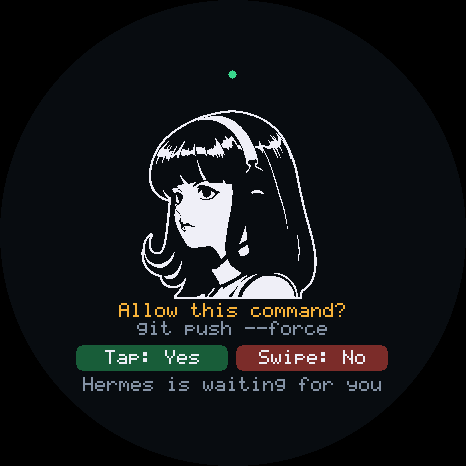
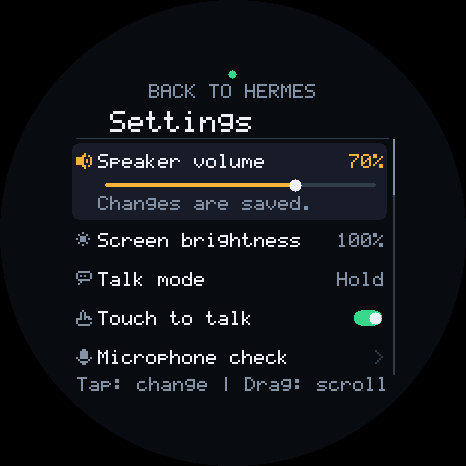
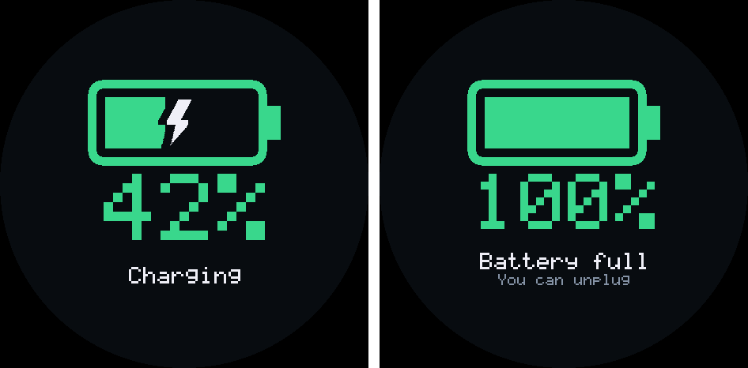
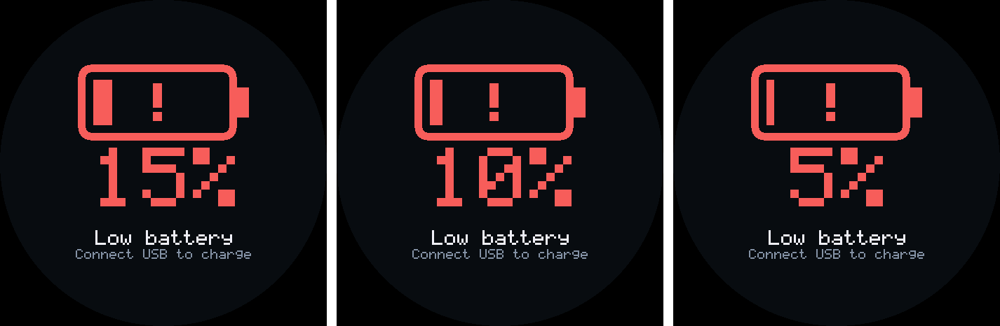
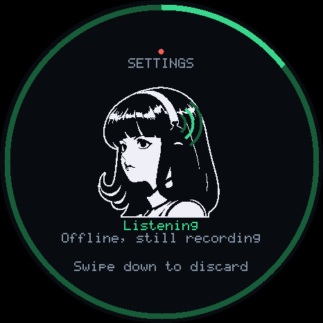
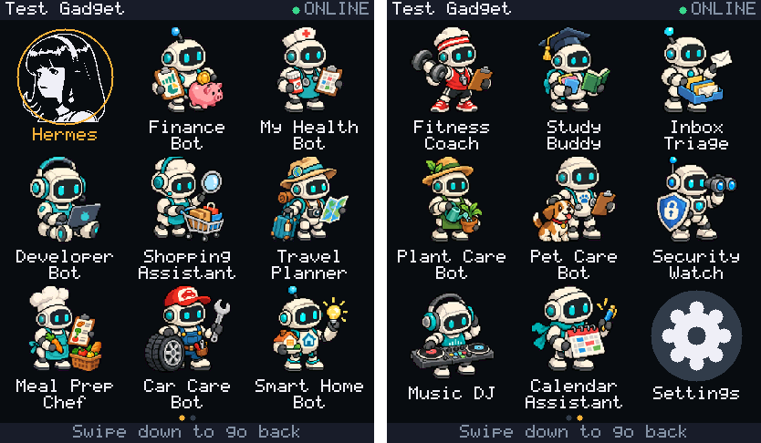
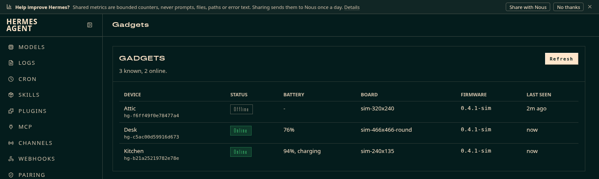
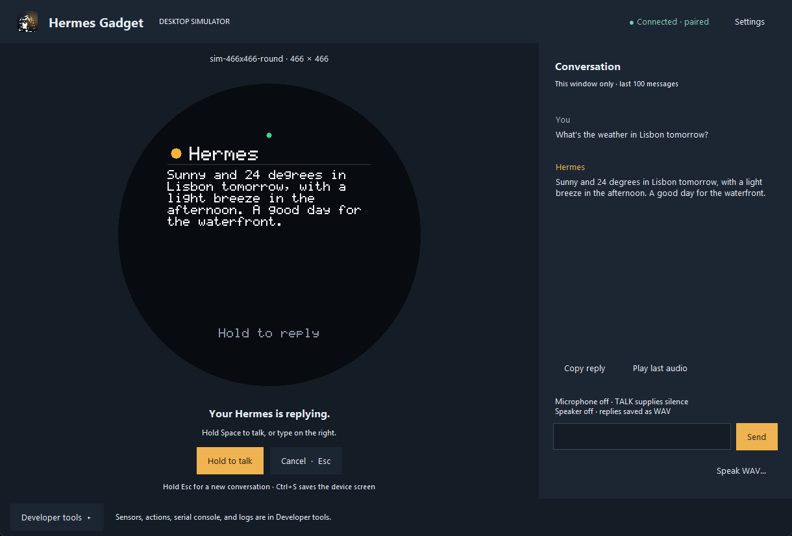

# Features

This page lists what a Hermes Gadget does today, grouped by what you do with it. Each line links to the guide that explains it. Some features need a board with a touchscreen, a speaker, a battery or PSRAM; the [hardware table](#supported-hardware) below shows which boards have what.

The screenshots come from the desktop simulator, which runs the same device core as the boards.

## Talk to Hermes and get replies

- **Hold to talk.** Hold TALK or the screen, speak, and release to send. [Talk, type, and interrupt](using-gadget.md)
- **Tap to talk.** A tap starts a recording and a pause in your speech ends it. Choose it with **Talk mode** in settings. [Device settings](using-gadget.md#device-settings-and-hardware-checks)
- **Spoken replies.** Hermes reads its reply aloud on boards with a speaker, and the text shows on screen. [Enable speech](connect-hermes.md#4-enable-speech)
- **A face that talks.** While Hermes speaks, the face moves its mouth with the reply's latest two lines under it, and the whole text follows. [The mascot](architecture.md#the-mascot)
- **Interrupt and cancel.** Hold TALK to talk over a reply, tap CANCEL to discard a recording or stop a turn, and hold CANCEL for a fresh conversation. [Talk, type, and interrupt](using-gadget.md)
- **Read a reply before the speech ends.** Tap the screen, or press Up or Down, to see the whole text at once. [Talk, type, and interrupt](using-gadget.md)
- **A reply you missed comes back.** If the screen went dark before you read a reply, the next wake shows it again from the top. [Device settings](using-gadget.md#device-settings-and-hardware-checks)
- **Long tasks.** Once Hermes starts a turn, the device waits up to 30 minutes for it to end, with the screen lit. [Device settings](using-gadget.md#device-settings-and-hardware-checks)
- **Confirmation questions.** Hermes asks before risky commands; TALK or a tap means yes, CANCEL or a swipe down means no. [Confirmations](hermes-integration.md#confirmations)
- **Cards and pictures.** The agent can put a reminder, a note or a picture on the screen. A card that arrives while the screen is dark waits for it to light. [Talk, type, and interrupt](using-gadget.md)
- **Timers.** Ask for a timer by voice. The time left shows on every screen, and the alarm beeps for a minute on boards with a speaker. [Timers](using-gadget.md#timers)
- **Device actions.** Hermes can change the volume, the brightness or the screen language, or run actions a board adds, such as an LED. [Device actions](protocol.md#device-actions)
- **Scheduled messages.** A Hermes cron job can deliver its result to a gadget. [Scheduled delivery](hermes-integration.md#scheduled-delivery)
- **Photos.** On a Waveshare P4 7B with an OV5647 camera, ask Hermes to take a picture; the plugin saves it as a PNG on the Hermes computer. [Talk, type, and interrupt](using-gadget.md)

## Screens, faces and settings

- **Status screens.** Ready, Listening, Thinking and Speaking each show the face and a short line about what is happening. [The mascot](architecture.md#the-mascot)
- **Round-screen ring.** On round displays, a ring at the edge shows recording time, a firmware update, a running timer, thinking and speaking. [Round screens](using-gadget.md#round-screens)
- **Resting clock.** After a chosen rest on Ready, the screen shows the time and date with the face. On round screens, the ring's marks and seconds dot turn a little each minute with the face, to spare the panel. Off by default. [Resting clock](using-gadget.md#resting-clock)
- **A face for each Hermes profile.** The device shows the face of the profile that answers it: a `gadget-face.bin`, or the profile's Hermes avatar. [Faces](faces.md#a-face-for-each-hermes-profile)
- **Colour faces that blink and talk.** On boards with PSRAM, an avatar shows in colour, and two extra pictures make it blink and move its mouth. [Faces](faces.md#a-face-for-each-hermes-profile)
- **Your own face.** Draw a face and turn it into a file the device shows. [Customize the face](faces.md)
- **Settings menu.** A scrolling list with an icon, a name and a value on each row, including **Hermes profile** and **Profiles per page** when Hermes offers several profiles. On a touchscreen, drag to scroll, tap to change, and use the slider for volume and brightness. [Device settings](using-gadget.md#device-settings-and-hardware-checks)
- **Hardware checks.** Microphone level, speaker tone, display colours, last button pressed, and device information, from the settings menu. [Device settings](using-gadget.md#device-settings-and-hardware-checks)
- **Screen timeout.** The screen dims, then goes dark after 30 seconds to 5 minutes of rest. Replies and questions wake it. [Device settings](using-gadget.md#device-settings-and-hardware-checks)
- **Device language.** The device's own text is in English or Spanish, or follows Hermes's language. [Language](using-gadget.md#language)
- **Chinese text.** A build option adds a font of about 7,000 Chinese characters. [Chinese text](cjk.md)

## Battery and power

- **Battery indicator.** An icon, a percentage or both at the top of the screen. It fills green while charging and turns red when low. [Device settings](using-gadget.md#device-settings-and-hardware-checks)
- **Battery estimate.** Boards that only read a voltage can show a rough percentage once you confirm a Li-ion cell is fitted. [Device settings](using-gadget.md#device-settings-and-hardware-checks)
- **Low battery alert.** The screen lights with a large red battery at the levels you choose, with an optional beep. Off by default. [Device settings](using-gadget.md#device-settings-and-hardware-checks)
- **Charging screen.** Plugging in USB lights the screen for 5 seconds with the charge level. An optional chirp goes with it. [Device settings](using-gadget.md#device-settings-and-hardware-checks)
- **Full battery notice.** When a charge finishes, the screen lights once with **Battery full**, and an optional chime plays. [Device settings](using-gadget.md#device-settings-and-hardware-checks)
- **Power off.** Shut down from settings on boards with a power driver. [Device settings](using-gadget.md#device-settings-and-hardware-checks)
- **Screen off with PWR.** On boards whose PWR key controls the screen, a short press turns it off and on; in the settings menu or the profile grid it goes back to the home screen. [Device settings](using-gadget.md#device-settings-and-hardware-checks)
- **Light sleep while dozing.** On some boards, the chip sleeps between Wi-Fi beacons while on battery with the screen dark. [Hardware verification](hardware-validation.md#waveshare-amoled-206-light-sleep-report)
- **Face-down sleep.** On boards with a motion sensor, laying the gadget on its screen darkens it and quiets Hermes. Off by default. [Device settings](using-gadget.md#device-settings-and-hardware-checks)

## Touch and buttons

- **Touch to talk.** On touchscreens with a TALK button, turn it off so only the button records; the screen still answers questions and works the menus. [Device settings](using-gadget.md#device-settings-and-hardware-checks)
- **Touch wakes screen.** Turn it off so a dark screen ignores touches and only a button lights it, for a gadget in a pocket. [Device settings](using-gadget.md#device-settings-and-hardware-checks)
- **Talk from a dark screen.** One press of TALK lights the screen and starts recording. Off by default. [Device settings](using-gadget.md#device-settings-and-hardware-checks)
- **Double press home.** Two quick presses of TALK go back to Ready and the default Hermes profile. [Device settings](using-gadget.md#device-settings-and-hardware-checks)
- **Swipe gestures.** A swipe down cancels, closes a card or list, and opens the sessions dashboard. A swipe from right to left on the idle screen opens the profile grid, and a sideways swipe there turns its page. [Talk, type, and interrupt](using-gadget.md)
- **Knob and scroll buttons.** On boards with Up and Down buttons or a knob, they scroll long replies, lists and the settings menu. [Device settings](using-gadget.md#device-settings-and-hardware-checks)

## Connection and reliability

- **Browser installer.** Install firmware from Chrome or Edge over USB, then set Wi-Fi, the Hermes address and the device name. [Set up a board](setup-board.md)
- **Wi-Fi setup from a phone.** The gadget opens a temporary network with a QR code; a page on your phone saves the new network. [Phone setup](setup-board.md#set-up-wi-fi-with-your-phone)
- **Several Wi-Fi networks.** The device keeps up to five and joins whichever is in range. [Saved Wi-Fi networks](hardware.md#saved-wi-fi-networks)
- **Updates over the air.** `hermes gadget update <device> --latest` installs a newer release. A build that cannot reach Hermes rolls itself back. [Manage an existing gadget](setup-board.md#manage-an-existing-gadget)
- **A recording survives a lost connection.** On boards with PSRAM to spare for the recording buffer, the device keeps recording while offline and sends the recording once it is back; a recording that ends offline is dropped after 45 seconds without a connection. [The recording buffer](architecture.md#the-recording-buffer)
- **Short network stalls.** A Wi-Fi hiccup of up to 10 seconds no longer closes the connection to Hermes. [Troubleshooting](troubleshooting.md#connection-and-pairing)
- **Slow links.** Boards with PSRAM use larger network buffers, so audio keeps up on a phone hotspot. [Network buffers](porting.md#network-buffers)
- **Why a connection dropped.** Each lost connection is logged with its reason, and `diag` keeps the last five. [Troubleshooting](troubleshooting.md#connection-and-pairing)
- **Diagnostics report.** Save a report from the browser installer or with `hermes-gadget diag` to attach to a bug report. [Save a board report](troubleshooting.md#save-a-board-report)
- **Away from home.** Reach Hermes from another network through Tailscale Funnel. [Connect from another network](tailscale-funnel.md)
- **Tailnet.** Experimental, and not in release images: a source build can join your Tailscale tailnet itself. [Reach Hermes over your tailnet](tailnet.md)
- **Phone app over Bluetooth.** Experimental and off on every board; a source build can turn it on. [Bluetooth](hardware-validation.md#bluetooth)

## Hermes profiles

- **Profile grid.** When the host offers several profiles, swipe from right to left on the idle screen of a touchscreen for a grid of icons with names, then tap one to switch to it. A sideways swipe turns the page. **Hermes profile** in settings opens the same grid; boards without a touchscreen switch to the next profile from there. On Hermes v0.22.5 and other versions without the routing hook it needs, messages to the new profile fail. [Device settings](using-gadget.md#device-settings-and-hardware-checks), [Hermes versions](hermes-integration.md#running-against-a-profile-or-a-multiplexed-gateway)
- **Up to 32 profiles.** The device keeps the default profile and up to 31 more, named as the Hermes interface names them. [Profile switching](hermes-integration.md#running-against-a-profile-or-a-multiplexed-gateway)
- **Profiles per page.** A page holds 3 x 3 by default; the **Profiles per page** setting chooses 2 x 2, 2 x 3, 3 x 3 or 4 x 4, and a small screen uses the largest grid whose icons stay about 7 mm. [Device settings](using-gadget.md#device-settings-and-hardware-checks)
- **A picture for each profile.** On boards with PSRAM, each profile's icon is its own face or Hermes avatar, sent by the plugin and updated when it changes. Other boards, and profiles with no picture, show the first letter in a colour of its own. [Thumbnails in the profile grid](faces.md#thumbnails-in-the-profile-grid)
- **Settings from the grid.** A gear cell after the last profile opens the settings menu. [Device settings](using-gadget.md#device-settings-and-hardware-checks)
- **Approval in each profile.** The first time you talk to a new profile, the screen shows the command that approves the gadget there. [Profile switching](hermes-integration.md#running-against-a-profile-or-a-multiplexed-gateway)
- **One profile per gadget.** The host can pin a device to its own profile, with its own model, memory and personality. [One profile per gadget](hermes-integration.md#one-profile-per-gadget)
- **Clear refusals.** A device that a profile route refuses shows "Refused by a route" and its device ID instead of waiting for a code. [Profile switching and profile routes](hermes-integration.md#profile-switching-and-profile-routes)

## The Hermes plugin and dashboards

- **Pairing.** Run `hermes gadget pair` on the Hermes computer to approve the code a new device shows. [Connect Hermes](connect-hermes.md)
- **Sessions on the device.** CANCEL or a swipe down opens a list of Hermes sessions, with busy ones in blue and those waiting for approval in amber. [The dashboard](using-gadget.md#watch-hermes-sessions-on-the-dashboard)
- **Status tiles.** Put up to eight lines, such as a NAS's state, on that list from a script on the host. [The dashboard](using-gadget.md#watch-hermes-sessions-on-the-dashboard)
- **Gadgets tab.** The Hermes web dashboard lists your devices with board, firmware, last seen, online state and battery. [The Gadgets tab](hermes-integration.md#the-gadgets-tab-in-the-hermes-dashboard)
- **Gadgets page in Hermes Desktop.** A gadget that runs in the desktop app's window, pairing with one click, a live copy of each device's screen, and buttons to send a card or run an action. [The Gadgets page](hermes-integration.md#the-gadgets-page-in-hermes-desktop)
- **Device commands.** `hermes gadget devices`, `info`, `pair`, `update` and `forget` manage devices from the host. [Hermes integration](hermes-integration.md#hermes-surfaces-the-sdk-uses)
- **Speech language.** Set the language gadget speech is transcribed in, whichever profile answers. [Fix the language of gadget speech](hermes-integration.md#fix-the-language-of-gadget-speech)
- **Faster replies.** Settings in Hermes that shorten the wait for an answer. [Making replies fast](hermes-integration.md#making-replies-fast)

## Desktop, Linux and the simulator

- **Desktop simulator.** Run the device on Windows, macOS or Linux, type or speak to it, and pick a board's screen size. [Try the simulator](desktop.md)
- **Scripted runs.** Drive the simulator from a script or from Python, without a window. [Simulator controls](simulator.md#headless-and-scripted-runs)
- **Demo server.** Try a scripted echo without Hermes. [Try the simulator](desktop.md#3-try-the-demo)
- **Raspberry Pi.** Experimental: run a gadget on a Pi 4 or 5 with USB audio, GPIO buttons and an optional screen. [Run a Linux gadget](linux.md)
- **Home Assistant and MQTT.** Examples expose a lamp and a temperature sensor to Hermes through a Linux gadget. [Home Assistant and MQTT](home-automation.md)
- **Your own board or action.** Add a board, a sensor or a device action. [Add a board or action](porting.md)

## Supported hardware

The table shows what each board profile drives. In the battery column, "Voltage" means the level comes from a voltage reading, which is rough, and "Voltage (measured curves)" that it follows charge and discharge curves measured on that board's cell; "Gauge" means a power chip reports it, though most gauges are not calibrated; "Estimate" means a charger chip reports a voltage and a percentage that are both uncalibrated estimates. Every board port is experimental until a complete physical report is recorded; the last column summarises how far testing has gone. See [Supported hardware](supported-hardware.md) for controls and setup, and [Hardware verification](hardware-validation.md) for the reports.

| Board | Touch | Microphone | Speaker | Battery level | Also | Tested on a board |
|---|---|---|---|---|---|---|
| ESP32-S3 breadboard build | No | Wired | Optional | No | TALK and CANCEL buttons | No report yet |
| Waveshare ESP32-S3-LCD-1.54 | Touch SKUs | Yes | Yes | Voltage | Light sleep | Partial report |
| Waveshare ESP32-S3-Touch-LCD-1.83 | Yes | Yes | Yes | Gauge | | Not run on a board |
| Waveshare ESP32-S3-Touch-LCD-1.46 | Yes | Yes | Yes | No | | Not run on a board |
| Waveshare ESP32-S3-Touch-AMOLED-1.32 | Yes | Yes | Yes | No | | Not run on a board |
| Waveshare ESP32-S3-Touch-AMOLED-1.43C | Yes | Yes | Yes | Voltage | | Not run on a board |
| Waveshare ESP32-S3-Touch-AMOLED-1.75 | Yes | Yes | Output, needs a speaker | Gauge | Face-down sleep, clock chip | Some features checked |
| Waveshare ESP32-S3-Touch-AMOLED-1.75C | Yes | Yes | Yes | Voltage (measured curves) | Light sleep | Report, on a branch build |
| Waveshare ESP32-S3-Touch-AMOLED-1.8 (V2) | Yes | Yes | Output, needs a speaker | Gauge | | Smoke test |
| Waveshare ESP32-S3-Touch-AMOLED-2.06 (watch) | Yes | Yes | Yes | Gauge | Light sleep, clock chip | Partial report |
| Waveshare ESP32-S3-Touch-AMOLED-2.16 | Yes | Yes | Yes | Gauge | Clock chip | Smoke test |
| Waveshare ESP32-S3-Touch-LCD-1.85C V2 | Yes | Yes | Speaker-box version | No | | Partial report |
| Waveshare ESP32-S3-Knob-Touch-LCD-1.8 | Yes | Yes | No | No | Knob | Smoke test |
| Espressif ESP-VoCat v1.2 | Yes | Yes | Yes | No | | Smoke test |
| Xorigin AIPI Lite | No | Yes | Yes | No | | Smoke test |
| Spotpear ESP32-S3-1.28-BOX | Yes | Yes | Yes | Voltage | | Not run on a board |
| Spotpear ESP32-S3-1.54 muma | Touch version | Yes | Yes | Voltage | Light sleep | Smoke test |
| Espressif ESP32-S3-BOX | Yes | Yes | Yes | No | | Not run on a board |
| Espressif ESP32-S3-Korvo-2 | Yes | Yes | Yes | Voltage | | Not run on a board |
| Espressif ESP32-S3-BOX-3 | Yes | Yes | Yes | No | | No report yet |
| M5Stack CoreS3 | Yes | Yes | Yes | Gauge | | No report yet |
| M5Stack StickS3 | No | Yes | Yes | Voltage | Face-down sleep | Smoke test |
| LilyGO T-Display-S3 | No | No | No | Voltage | Text through the USB console | Smoke test |
| Elecrow CrowPanel 2.1-inch HMI | Yes | No | No | No | Knob; text through the USB console | Smoke test |
| Elecrow CrowPanel 5.0-inch HMI | Yes | No | No | No | Text through the USB console | Boot check |
| ESP32-2432S028 CYD | No | Optional, on the header | Beeps only | No | Text through the USB console | Smoke test, earlier build |
| Elecrow CrowPanel Advanced 10.1-inch ESP32-P4 | Yes | Yes | Yes | Estimate (STC8) | | Partial report, earlier build |
| Waveshare ESP32-P4-WIFI6-Touch-LCD-7B | Not yet checked | Initialised, not yet checked | Initialised, not yet checked | No | Camera | Smoke test |
| Waveshare ESP32-P4-WIFI6-Touch-LCD-3.4C | Yes | Yes | Yes | No | | Partial report |
| Raspberry Pi 4 or 5 | Optional screen | USB audio | USB audio | No | GPIO buttons and outputs | No report yet |

Every board with a display can show the resting clock and run timers. Boards with PSRAM also keep a recording through a lost connection (when the recording buffer fits), show colour faces, and show each profile's picture in the profile grid. Voice needs [speech recognition and text-to-speech in Hermes](connect-hermes.md#4-enable-speech); boards without audio show replies as text.
