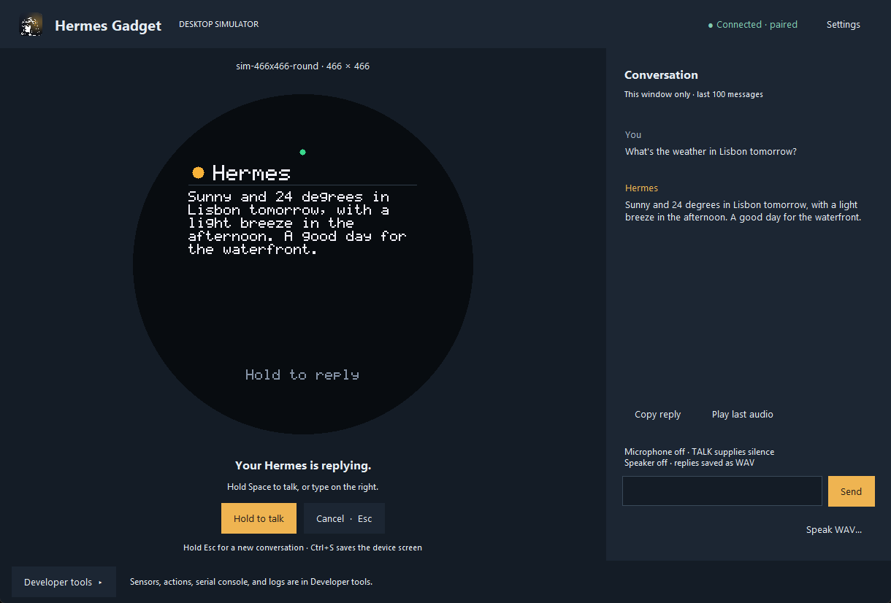

# The simulator

New here? Follow [Try the simulator](desktop.md) for installation and your first conversation. This page covers controls, board profiles, and scripting.

`hermes-gadget sim` runs the **production device core** (`firmware/core`) as a shared library inside a Python host.

**Real code, same as on the ESP32:**

- protocol, authentication and enrollment;
- reconnect and backoff, heartbeat, pairing UX;
- push-to-talk and VAD, playback control;
- the UI renderer, device actions, telemetry, the serial console.

**Simulated, replacing the drivers:**

- Wi-Fi: a checkbox;
- the WebSocket: Python `websockets`;
- the display: a Tk window;
- microphone and speaker: WAV files, or PC audio with `--live-audio`;
- NVS: a JSON file;
- buttons: the keyboard.

A bug reproduced in the simulator is therefore a bug in the firmware.

## Running

The main window shows the device and the current conversation. **Developer tools** replaces the conversation panel with sensors, device actions, the serial console, and logs. Choose **Back to conversation** to return.

**Settings** changes the gateway address, board profile, microphone, and speaker. Audio uses the system's default devices; change those in your operating system's sound settings. A board change restarts the simulated device and keeps its stored identity. Large boards use a smaller zoom to fit the display, including half size on short screens.

Typed messages and voice transcripts appear beside replies as they stream. **Copy reply** copies the latest reply. **Play last audio** replays the latest recorded reply through the computer's default output. Conversation text stays in memory, limited to the last 100 messages, and clears when you start a new session. Audio files remain in the state directory described below.



```bash
hermes-gadget build-sim                     # once, and after changing firmware/core
hermes-gadget sim --url ws://127.0.0.1:8765/gadget [--board sim-320x240] [--name "Desk"] [--live-audio]
```

A first session, start to finish:

1. Start Hermes with the gadget plugin (or `hermes-gadget devserver --pairing` for a stand-in that needs no Hermes).
2. Run `hermes-gadget sim --url ws://127.0.0.1:8765/gadget --live-audio --board sim-466x466-round`.
3. The screen shows a pairing code. Approve it on the Hermes host: `hermes gadget pair` (or `hermes pairing approve gadget <CODE>`).
4. Hold **Space**, ask something, let go. Hermes answers on screen and through your speakers.
5. Hold **Esc** for 2 s to start a fresh conversation.

| Input | Action |
|---|---|
| Hold **Space** / TALK button | Push-to-talk |
| **Esc** / CANCEL | Discard a recording, close a card, stop a turn; on the idle screen, open or close the [dashboard](using-gadget.md#watch-hermes-sessions-on-the-dashboard). With `hermes-gadget devserver`, type `dashboard` there to send sample sessions and tiles |
| Hold **Esc** / CANCEL for 2 s | Start a new Hermes session (`/new`); a countdown shows in the hint bar |
| Hold **Space + Esc** for 1 s | Open or close the device's settings and local hardware checks |
| **Space** / **Esc** on a question | Answer yes / no |
| **Up / Down** | Scroll a long reply (long replies also page by themselves) |
| **Ctrl+S** | Save a PNG screenshot into the state directory |
| Text box | Send a typed message, as from a keyboard device |
| **Speak WAV...** | Hold TALK while a WAV file plays into the microphone |
| **Settings** | Change the gateway, board profile, or live audio; reconnect |
| **Developer tools**, Wi-Fi checkbox | Simulate losing the network |
| **Developer tools**, Face down checkbox | Lay a board with a motion sensor face down, or turn it back over; with face-down sleep on, the screen sleeps and Hermes stays quiet |
| **Developer tools**, sensors | Battery and temperature sliders, reported to Hermes as telemetry |
| **Developer tools**, serial console | The same commands as the board's UART console (`help`, `status`, `set server ...`) |
| **Developer tools**, Power (simulated) | Supply a complete power-driver reading, independently of the generic telemetry sliders |

The simulated device registers two demo actions the agent can use: `led.set` (a virtual LED in the window) and `buzzer.beep`.

The [device settings menu](using-gadget.md#device-settings-and-hardware-checks) runs in the native firmware core. On touch profiles, hold the device title bar to open it; on `sim-466x466-round`, hold the **SETTINGS** target under the status dot. You can also enter `settings` in the serial console. The desktop **Settings** dialog configures the simulator host; the device menu changes saved volume, brightness, talk mode, and (when Hermes offers several) the Hermes profile.

State lives in `~/.hermes-gadget/sim/<name>/` (override with `--state-dir`):

- `nvs.json`: device key and settings. Delete it to look like a brand-new device.
- `audio/`: every reply the speaker played, as WAV.
- `screenshots/`: screenshots saved with Ctrl+S.
- `update.bin`: the last firmware image installed over the air.

### Simulated power

Power starts unavailable. In **Developer tools → Power (simulated)**, select **Read available**, enter **Battery mV** and/or **Battery %**, and choose **Unknown**, **Yes**, or **No** for presence, charging, and external power. Blank numeric entries mean unknown. **Apply power reading** replaces the entire reading; invalid input preserves the last applied reading. The production firmware polls within five seconds. Uncheck availability and apply to clear it; changing controls alone never applies a reading.

The **Telemetry battery %** slider remains an independent generic sensor, not the header battery source. No estimator or indicator is automatically enabled. To preview the LCD-1.54's approximate display estimate, use `sim-240x240`, name `Waveshare 1.54`, enter `set battery_estimate liion` then `set battery_display percentage` in the console, and apply 3750 mV with no native percentage: the header shows 50%. See the [fitted-battery caveat and estimate limitations](using-gadget.md#device-settings-and-hardware-checks) before enabling this on hardware.

Rebuilding the window for a board change or starting a new simulator resets the power fixture to unavailable. Firmware settings persist in `nvs.json`; fixtures do not. Rebuild the simulator library after this ABI 8 update, which adds the host's wall-clock time for the resting clock; Linux native-core clients still default to no power device.

Like a board, the simulated device takes firmware updates (`hermes gadget update`, or `update <path>` in the dev server). It checks the image the way the core does and keeps only ESP32 app images. Then it "restarts": it drops the connection and connects again, still running the simulator.

## Boards

| Board | Screen | Notes |
|---|---|---|
| `sim-320x240` | 320×240 | Default; matches the reference breadboard |
| `sim-240x135` | 240×135 | Small TFT; text drops to scale 1 |
| `sim-480x320` | 480×320 | Larger panel |
| `sim-240x240` | 240×240 | The 1.54" LCD board: two buttons, no scroll buttons, so long replies page by themselves |
| `sim-240x240-nospeaker` | 240×240 | No speaker, so replies stay text only |
| `sim-240x240-round` | 240×240 round | The Spotpear 1.28-BOX touch board, the smallest round screen, with the same controls as `sim-466x466-round` |
| `sim-360x360-round` | 360×360 round | The 1.85C V2 LCD touch board, with the same controls as `sim-466x466-round` |
| `sim-466x466-round` | 466×466 round | The 1.75" AMOLED touch board: hold the mouse on the screen to talk, click to answer yes, drag down to cancel. It has a simulated motion sensor for face-down sleep. No scroll buttons, so long replies page by themselves |
| `sim-368x448` | 368×448 | The 1.8" rectangular AMOLED touch board: hold the mouse on the screen to talk, click to answer yes, drag down to cancel. No scroll buttons |
| `sim-410x486` | 410×486 | The 2.06" AMOLED watch's display window: hold the mouse to talk, click to answer yes, drag down to cancel. No scroll buttons. Does not model the glass's rounded corners or microphone gain |
| `sim-480x480` | 480×480 | The 2.16" square AMOLED touch board: hold the mouse to talk, click to answer yes, drag down to cancel. No scroll buttons |
| `sim-480x480-round-nospeaker` | 480×480 round | A round touch board with no microphone or speaker, like the CrowPanel 2.1. Timers show their countdown and alarm, silently. No scroll buttons |

Add a profile to `BOARDS` in `python/hermes_gadget/sim/runner.py` to mirror new hardware.

## Headless and scripted runs

```bash
hermes-gadget sim --headless --url ws://127.0.0.1:8765/gadget --script examples/scripts/smoke.txt
```

Script commands, one per line:

| Command | Effect |
|---|---|
| `wait <screen>[\|<screen>] [timeout]` | Wait until the device shows that screen |
| `text <message>` | Send a typed message |
| `press` / `release` / `tap` `<talk\|cancel\|up\|down>` | Button input |
| `wav <file>` | Speak a WAV file (holds TALK for its length) |
| `sleep <seconds>` | Keep the device running |
| `console <line>` | Run a serial-console command |
| `status` | Print the device status |
| `screenshot <file.png>` | Save the screen |
| `power <JSON-object-or-null>` | Replace the simulated power reading; `null` makes it unavailable; wait at least five seconds for polling |
| `facedown <on\|off>` | Lay the board face down, or turn it back over; boards with a motion sensor only |
| `time <YYYY-MM-DDTHH:MM>` \| `time now` | Pin the simulated clock's time at that moment, or follow the computer's clock again |
| `expect <text>` | Fail unless the last reply contains `<text>` |

Screens are `boot`, `offline`, `connecting`, `pairing`, `ready`, `listening`, `thinking`, `responding`, `card`, `image`, `prompt`, `updating`, `settings`, `setup`, `dashboard`, `profiles`, `alarm`, `clock` and `error`. The `setup` screen belongs to the ESP32 phone-setup flow; the simulator does not start a Wi-Fi access point.

For example, after `wait ready 20`:

```text
console set battery_estimate liion
console set battery_display percentage
power {"battery_mv":3750,"charging":false}
sleep 5.2
status
screenshot /tmp/hg-battery-50.png
power null
sleep 5.2
status
```

Power objects accept only `battery_present`, `battery_mv`, `battery_percent`, `charging`, and `external_power`. Missing fields or JSON `null` values are unknown; `{}` is an available reading with every field unknown. Booleans must be `true`/`false`, voltage an integer 0–65535, and percentage an integer 0–100; booleans are not numeric inputs. Invalid JSON, keys, types, or ranges stop a script with a line-numbered error and leave the applied fixture unchanged. Voltage-only `status.power` never gains a derived `battery_percent`, even when the header displays an estimate.

## Using it from Python

```python
from pathlib import Path

from hermes_gadget.sim import Simulator

sim = Simulator(url="ws://127.0.0.1:8765/gadget", state_dir=Path("/tmp/dev1"))
sim.start()
sim.wait_screen("ready")
sim.type_text("what's the weather?")
sim.wait_for(lambda: sim.last_received("turn.end") is not None, timeout=60)
print(sim.last_received("reply")["text"])
sim.screenshot("reply.png")
sim.close()
```

Use `sim.set_power({"battery_mv": 3750, "charging": False})` for the same complete replacement from Python, or `sim.set_power(None)` to clear it. `sim.power_status` holds the last successfully applied host fixture. Advance normal polling with `sim.run_for(5.2)` before observing the device; setting inputs does not directly change its model.

`tests/test_sim_hub.py` and `tests/test_gateway_e2e.py` are worked examples.
